# 🛡️ Awesome Intellectual Property Infringement Monitors

  

  
  
  
  
  
  

---

## 📖 Overview

A definitive, SEO-optimized curated directory of enterprise **SaaS platforms**, AI brand safety solutions, and **open-source tools** engineered for **Intellectual Property (IP) Infringement Monitoring**, counterfeit detection, domain squatting investigation, copyright tracking, and digital risk protection (DRP).

Whether safeguarding enterprise trademarks, investigating typosquatting in package registries (npm/PyPI), detecting code plagiarism, or uncovering copyright infringement across multimodal AI training corpora, this ecosystem directory catalogs both industry standard solutions and community-built open-source security toolkits.

---

## 📑 Table of Contents

- [📊 Sector Overview & Market Dynamics](#-sector-overview--market-dynamics)
- [☁️ SaaS & Hosted Enterprise Platforms](#️-saas--hosted-enterprise-platforms)
- [💻 Open-Source GitHub Projects](#-open-source-github-projects)
- [📚 Additional Open-Source & Research Tools](#-additional-open-source--research-tools)
- [🤝 How to Contribute](#-how-to-contribute)
- [⭐ Star History](#-star-history)
- [💖 Support & Sponsor](#-support--sponsor)
- [⚠️ Disclaimer](#️-disclaimer)

---

## 📊 Sector Overview & Market Dynamics

The global brand protection and intellectual property infringement monitoring software market is valued at approximately **$1.21 billion to $3.20 billion** in 2026, projected to surpass **$3.7 billion to $6.6 billion by 2030–2034** at an estimated CAGR of 9.5% to 18%. 

The sector is **moderately fragmented yet undergoing accelerated private-equity consolidation**: while legacy enterprise suites (such as Corsearch, ZeroFox, and MarkMonitor) capture large multi-year enterprise legal contracts through continuous M&A roll-ups, widespread disruption from generative AI, marketplace proliferation, and domain spoofing continues to fuel a diverse long-tail of agile AI-native startups and niche point solutions rather than resulting in a single winner-take-all monopoly.

---

## ☁️ SaaS & Hosted Enterprise Platforms

The table below catalogs leading commercial brand safety, anti-piracy, and intellectual property infringement monitoring SaaS providers, sorted in descending order by estimated enterprise scale (annual revenue / valuation):

| Product | Enterprise Scale (Revenue / Valuation) | Description & Key Capabilities | Specific Pricing (Starting Tier) | Free Tier / Free Trial Limits |
| :--- | :--- | :--- | :--- | :--- |
| **[ZeroFox](https://www.zerofox.com/)** | **~$250M+ ARR** / Peak $1.4B valuation (Acquired by Haveli Investments) | External cybersecurity & digital risk protection covering social media brand abuse, dark web leaks, phishing domains, and executive threat monitoring. | Starts at **$30,000/year** (~$2,500/month billed annually) for core digital risk bundles. | **No free tier**; 30-day guided proof-of-concept (PoC) evaluation available upon enterprise qualification. |
| **[Corsearch](https://corsearch.com/)** | **~$200M–$337M ARR** / Multi-billion PE backing (Astorg / Cobepa) | Comprehensive brand protection and anti-counterfeiting suite featuring **TrademarkNow** for lifecycle trademark screening and digital content protection across global marketplaces. | Starts at **$18,000/year** (~$1,500/month billed annually) for entry-level brand monitoring packages. | **No free tier**; single-session interactive guided product demo with custom sample brand risk audit (no self-serve free trial). |
| **[OpSec Security](https://www.opsecsecurity.com/)** | **~$100M+ ARR** / Acquired by Crane NXT for ~$270M | Hybrid physical and digital brand security platform integrating anti-counterfeiting holograms, on-product track-and-trace, and digital domain/marketplace threat monitoring. | Starts at **$24,000/year** (~$2,000/month billed annually) for digital brand monitoring modules. | **No free tier**; no public self-serve trial (custom enterprise compliance consultation and vulnerability assessment only). |
| **[PhishLabs](https://www.phishlabs.com/)** | **~$60M+ ARR** (Part of Fortra) | Threat intelligence and digital risk protection platform specialized in enterprise phishing takedown, domain spoofing detection, and social media brand impersonation mitigation. | Starts at **$15,000/year** (~$1,250/month billed annually) for managed threat takedown feeds. | **No free tier**; prospective enterprise clients receive a scheduled demonstration with a one-time external domain threat exposure scan. |
| **[Red Points](https://www.redpoints.com/)** | **~$35M–$50M ARR** / $80M+ total venture funding | AI-driven online counterfeit detection and automated marketplace takedown platform scanning 5,000+ online marketplaces and social networks with image recognition. | Starts at **$950/month** (~$11,400/year billed annually) for basic marketplace & trademark enforcement. | **No free tier**; no self-serve free trial (offers a scheduled personalized demo and free initial brand audit report). |
| **[Pointer Brand Protection](https://www.pointerbrandprotection.com/)** | **~$25M ARR** (Division of Corsearch) | Specialized brand protection and anti-counterfeiting investigation services combining algorithmic web scraping with dedicated multilingual legal analysts. | Starts at **$12,000/year** (~$1,000/month billed annually) for focused marketplace coverage. | **No free tier**; no self-serve free trial (offers customized brand exposure audit upon consultation). |
| **[MarqVision](https://marqvision.com/)** | **~$15M–$20M ARR** / Series A funded ($30M+ raised) | AI-powered IP operating system specialized in automated counterfeit detection, trademark infringement removal, and unauthorized distribution monitoring across Asian & global marketplaces. | Starts at **$1,000/month** ($12,000/year billed annually) for foundational e-commerce seller monitoring. | **No free tier**; provides a 14-day assisted pilot evaluation with initial catalog risk scanning upon sales qualification. |
| **[BrandShield](https://www.brandshield.com/)** | **~$14M ARR** / ~$10M ARR (Privatized from London AIM) | Robust digital risk protection platform offering AI-driven threat hunting for phishing sites, rogue mobile apps, executive impersonation, and counterfeit listings. | Starts at **$1,800/month** (~$21,600/year billed annually) for core anti-phishing and domain surveillance. | **No free tier**; offers a scheduled live walkthrough and a complimentary external brand digital risk report. |
| **[AppDetex](https://www.appdetex.com/)** | **~$10M–$15M ARR** (Tracer) | Mobile application and digital channel brand protection tracking rogue apps in third-party APK repositories, domain cybersquatting, and social abuse. | Starts at **$15,000/year** (~$1,250/month billed annually) for mobile app and domain detection tiers. | **No free tier**; custom demonstration and rogue app inventory scan upon consultation (no public self-serve trial). |
| **[Smart Protection](https://smartprotection.com/)** | **~$8M–$12M ARR** / $20M+ venture funding | European brand protection and anti-piracy SaaS dedicated to fast content delisting, counterfeit product tracking, and digital media live-stream antipiracy protection. | Starts at **$10,000/year** (~$833/month billed annually) for single-vertical content monitoring. | **No free tier**; provides a free initial brand piracy diagnostic scan and structured platform demo upon request. |

---

## 💻 Open-Source GitHub Projects

Explore verified open-source solutions for domain lookalike detection, typosquatting permutation generation, package registry abuse monitoring, code plagiarism analysis, and AI model copyright verification.

Sorted by **GitHub Star Count** (descending):

| Repository & Link | GitHub Stars | License | Primary Focus & Architecture |
| :--- | :--- | :--- | :--- |
| **[dnstwist](https://github.com/elceef/dnstwist)** |  | Apache-2.0 | **Domain permutation & typosquatting engine**: The gold standard for detecting homoglyph attacks, keyboard-slip lookalikes, TLD swaps, and brand impersonation domains. Generates DNS queries, MX checks, and web screenshot comparisons. |
| **[JPlag](https://github.com/jplag/JPlag)** |  | GPL-3.0 | **Source code plagiarism detection**: Widely recognized academic and industry system finding code plagiarism and collusion across Java, C++, Python, JavaScript, and more using token-string comparison algorithms. |
| **[opensquat](https://github.com/atenreiro/opensquat)** |  | GPL-3.0 | **Newly registered domain lookalike scanner**: Proactively discovers newly registered domains that impersonate corporate brands by scanning daily WHOIS feeds and Certificate Transparency (CT) logs. |
| **[urlcrazy](https://github.com/urbanadventurer/urlcrazy)** |  | Ruby License | **Domain typosquatting & phishing candidate tester**: Generates 15 distinct domain typo variations (bitsquatting, homophones, vowel swapping) to detect brand squatting and email hijacking. |
| **[Dolos](https://github.com/dodona-edu/dolos)** |  | MIT | **Modern code plagiarism & similarity engine**: University of Ghent project designed to discover code plagiarism even through AST refactoring and code obfuscation. Features an interactive web visualizer and CLI. |
| **[dnsmorph](https://github.com/edoardogerosa/dnsmorph)** |  | MIT | **High-performance Go domain permutation engine**: Fast, multi-threaded domain lookalike and typo generator tailored for real-time reconnaissance and brand threat hunting. |
| **[certainly](https://github.com/happycakefriends/certainly)** |  | GPL-3.0 | **Offensive and defensive bitflip/typosquat traffic auditor**: Tool for evaluating typosquatting exposures and capturing misdirected traffic across network protocols. |
| **[twistrs](https://github.com/haveibeensquatted/twistrs)** |  | MIT | **Rust-powered domain permutation library**: Asynchronous, blazing-fast domain enumeration engine designed for high-scale brand monitoring backend pipelines. |
| **[homographic_spoofing](https://github.com/basecamp/homographic_spoofing)** |  | MIT | **Basecamp IDN homograph sanitizer**: Lightweight Ruby utility for detecting and sanitizing internationalized domain name (IDN) homoglyphic spoof attacks in URLs and inbound sender emails. |
| **[domainthreat](https://github.com/PAST2212/domainthreat)** |  | MIT | **Newly registered domain scraper & brand auditor**: Continuously crawls newly registered domains with subdomain enumeration, screenshot capture, and HTML fingerprint scraping. |
| **[Logalyze](https://github.com/gokulkumaran03-tbg/Logalyze)** |  | MIT | **AI counterfeit logo & seller authenticator**: Computer vision application that scans product listings to detect counterfeit trademark logos and unauthorized reseller storefronts. |
| **[ROBIN++](https://github.com/Hannah1102/ROBIN)** |  | Research / Open | **Dual-domain watermark for diffusion models**: IEEE 2026 framework providing copyright protection, intellectual property provenance, and tamper localization for AI-generated images. |
| **[nettfiske](https://github.com/wisespace-io/nettfiske)** |  | MIT | **Certificate transparency phishing & brand scanner**: Live-streams Certificate Transparency logs to pinpoint malicious lookalike SSL/TLS domain registrations in real time. |
| **[SheriffMark](https://github.com/arunprasad/sheriffmark)** |  | AGPL-3.0 | **Self-hosted brand protection platform**: Single-binary Go/SQLite solution that monitors lookalikes, typosquats, and combosquats with evidentiary records and takedown reporting. |
| **[risk-monitor-tool](https://github.com/muzammilmunir/risk-monitor-tool)** |  | MIT | **All-in-one brand risk monitoring dashboard**: Combines domain permutation alerts, social media account monitoring (Sherlock integration), spam scoring, and trademark search. |
| **[brandguard](https://github.com/Baneado98/brandguard)** |  | MIT | **Software supply-chain brand typosquatting monitor**: Detects malicious packages impersonating proprietary brands on npm, PyPI, and GitHub with automated takedown notice drafts and MCP server support. |
| **[Copyscale](https://github.com/aneenajosan/Copyscale)** |  | Open-Source | **AI training copyright infringement analyzer**: Multi-layer neural network evaluating whether machine learning diffusion and vision models incorporated copyrighted artworks in training sets. |

---

## 📚 Additional Open-Source & Research Tools

- **[Sieve Scope](https://pypi.org/project/sieve-scope/)** — Fully local, zero-dependency, deterministic code plagiarism and structural similarity detection engine with a 7-bit observation space (H1–H7) for explainable forensic analysis.
- **[csim-ai](https://pypi.org/project/csim-ai/)** — Neural-augmented Python code plagiarism detector pairing ANTLR4 parse-tree normalization with contrastive bi-encoders and GBDT fusion.
- **[UniMark](https://ar5iv.labs.arxiv.org/html/2512.12324)** — Multimodal watermarking and AI-generated content identification toolkit for tracking intellectual property in synthetic data.
- **[semantic-copycat-minner](https://packages.ecosyste.ms/registries/pypi.org/packages/semantic-copycat-minner)** — Semantic analysis tool detecting AI-generated code derived from copyrighted source repositories.
- **Community n8n Brand Alert Workflows** — Open-source automation blueprints integrating Slack, Telegram, Jira, and WHOIS APIs for automated triage and DMCA notice generation.

---

## 🤝 How to Contribute

We welcome additions, corrections, and updates from brand protection professionals, security researchers, and developers!

1. 🍴 Fork the repository.
2. 🌿 Create a descriptive branch: `git checkout -b add-tool-name`.
3. ✍️ Update `README.md` following the standardized table structure (include specific starting pricing, explicit free trial/tier limits, or GitHub star badge links).
4. 🚀 Submit a Pull Request detailing the tool's focus and licensing.

---

## ⭐ Star History

---

## 💖 Support & Sponsor

Thank you for visiting and using this resource! If you find this directory valuable for your security team, research, or brand monitoring operations, please consider:
- ⭐ **Starring** the repository on GitHub
- 🍴 **Forking** and contributing new tools
- 📢 **Sharing** this guide with colleagues across cybersecurity and legal tech

Want to support ongoing maintenance and new curated security projects?  
👉 **[Sponsor on GitHub / Buy a Coffee](https://github.com/sponsors/ishandutta2007)** ☕

---

## ⚠️ Disclaimer

- 📌 This list is a **community-curated directory** created for educational and informational purposes. It does not constitute formal legal advice or an endorsement of any particular vendor.
- ⚖️ Intellectual property monitoring, domain reconnaissance, and automated takedown workflows must comply with relevant local and international copyright and privacy frameworks (e.g., DMCA, GDPR, ICANN UDRP). **Qualified IP counsel is indispensable** for formal filings.
- 📄 **Takedown notices generated by monitoring tools are advisory drafts**, not binding legal judgments. The rights holder remains solely liable for claims served to domain registrars, hosting companies, and search engines.
- 🔒 Self-hosted security platforms require ongoing vulnerability patching, hardened access controls, and strict audit logs to guarantee that collected evidence meets admissibility standards for legal proceedings.
